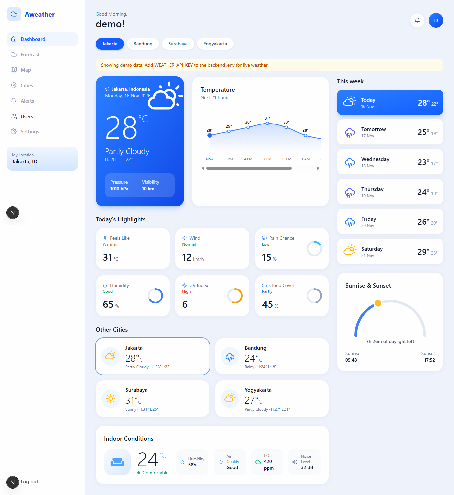
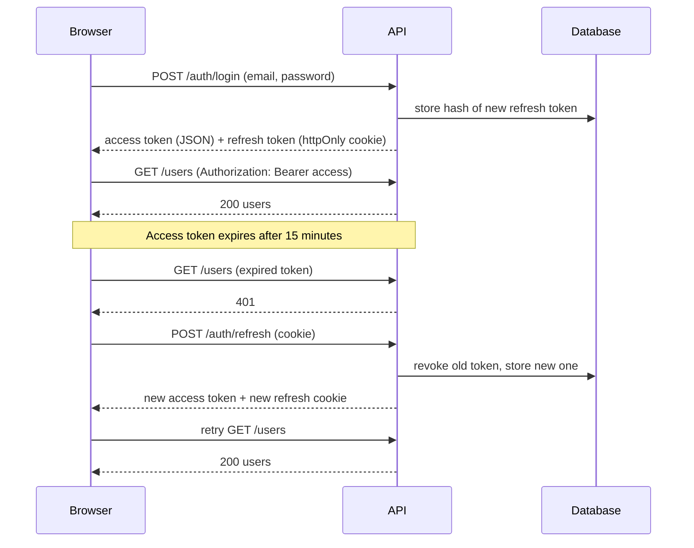

<div align="center">

# Aweather

**A full-stack weather dashboard with secure JWT authentication.**

Next.js · Express · PostgreSQL · Prisma


</div>

<!-- Add a screenshot of the dashboard here: -->



## Overview

Aweather shows current conditions, an hourly temperature curve, a 6-day forecast, sunrise/sunset, and a set of daily highlights for several Indonesian cities. Every data endpoint sits behind a JWT guard, and sessions use short-lived access tokens paired with rotating refresh tokens.

The project was built to demonstrate a complete, production-minded auth flow on a real-feeling UI, not only a login form.

## Features

**Weather dashboard**
- Current conditions with high/low, pressure and visibility
- Smooth hourly temperature chart (next 21 hours)
- 6-day forecast list
- Highlights: feels like, wind, rain chance, humidity, UV index, cloud cover
- Sunrise/sunset arc with live sun position and daylight remaining
- Switch cities from the tabs or the "Other Cities" cards
- Indoor conditions panel
- Responsive layout with a collapsible sidebar on mobile

**Authentication & security**
- Register, login, logout, and automatic session restore on page load
- JWT access token (15 min), kept in memory only, never in `localStorage`
- Refresh token (7 days) in an `httpOnly` cookie scoped to `/api/auth`
- Refresh token **rotation** with **reuse detection**: replaying a used token revokes every session for that user
- Refresh tokens are stored as SHA-256 hashes, so a database leak does not expose usable tokens
- Passwords hashed with bcrypt; identical error for wrong password and unknown email
- Request validation with Zod, rate limiting on auth routes, `helmet` headers, strict CORS
- Protected `/users` page backed by a JWT-guarded endpoint

## Tech stack

| Layer | Technology |
|---|---|
| Frontend | Next.js (App Router), React, Tailwind CSS, react-icons |
| Backend | Node.js, Express |
| Database | PostgreSQL with Prisma ORM |
| Auth | JSON Web Tokens (access + rotating refresh), bcrypt |
| Validation | Zod |
| Testing | Jest, Supertest |
| Weather data | OpenWeatherMap (optional; demo data built in) |

## How authentication works



If a refresh token that was already rotated is presented again, the API treats it as theft and revokes all of that user's refresh tokens.

## Getting started

### Prerequisites

- Node.js 20 or newer
- PostgreSQL installed locally ([postgresql.org](https://www.postgresql.org/download/))
- Optional: a free [OpenWeatherMap](https://openweathermap.org/api) API key for live weather

### 1. Clone

```bash
git clone https://github.com/YomiAdiFitroh/aweather.git
cd aweather
```

### 2. Backend

```bash
cd backend
cp .env.example .env      # Windows: copy .env.example .env
```

Edit `backend/.env` (see [Environment variables](#environment-variables)), then:

```bash
npm install
npx prisma migrate dev --name init
npm run dev
```

The API runs on `http://localhost:4000`. `prisma migrate dev` creates the `aweather` database if it does not exist. To create it yourself instead:

```bash
psql -U postgres -c "CREATE DATABASE aweather;"
```

Generate strong JWT secrets with:

```bash
node -e "console.log(require('crypto').randomBytes(48).toString('hex'))"
```

### 3. Frontend

In a second terminal:

```bash
cd frontend
cp .env.example .env.local   # Windows: copy .env.example .env.local
npm install
npm run dev
```

Open `http://localhost:3000`, create an account, and you will land on the dashboard.

> Without a `WEATHER_API_KEY`, the backend serves built-in demo data and the dashboard shows a notice. Add a key for live weather.

## Environment variables

**`backend/.env`**

| Variable | Required | Description |
|---|---|---|
| `DATABASE_URL` | Yes | PostgreSQL connection string |
| `JWT_ACCESS_SECRET` | Yes | Secret for signing access tokens |
| `JWT_REFRESH_SECRET` | Yes | Secret for signing refresh tokens (use a different value) |
| `PORT` | No | API port (default `4000`) |
| `FRONTEND_URL` | No | Allowed CORS origin (default `http://localhost:3000`) |
| `WEATHER_API_KEY` | No | OpenWeatherMap key; leave empty for demo data |

**`frontend/.env.local`**

| Variable | Required | Description |
|---|---|---|
| `NEXT_PUBLIC_API_URL` | No | API base URL (default `http://localhost:4000/api`) |

## API reference

| Method | Endpoint | Auth | Description |
|---|---|---|---|
| `POST` | `/api/auth/register` | Public | Create an account |
| `POST` | `/api/auth/login` | Public | Sign in |
| `POST` | `/api/auth/refresh` | Refresh cookie | Rotate refresh token, get a new access token |
| `POST` | `/api/auth/logout` | Refresh cookie | Revoke the refresh token |
| `GET` | `/api/auth/me` | Access token | Current user |
| `GET` | `/api/users` | Access token | List users |
| `GET` | `/api/weather/dashboard?city=Jakarta` | Access token | Full dashboard payload for a city |
| `GET` | `/api/weather/cities` | Access token | Summary for all supported cities |
| `GET` | `/api/health` | Public | Health check |

Supported cities: Jakarta, Bandung, Surabaya, Yogyakarta. Any other value returns `400`.

## Testing

```bash
cd backend
npm test
```

The suite has 33 tests and runs against an in-memory fake of the Prisma client, so no database is needed.

| Area | Positive cases | Negative cases |
|---|---|---|
| Register | Creates user, sets httpOnly cookie, never returns the password hash | Duplicate email, invalid email, short password, empty body |
| Login | Valid credentials, case-insensitive email | Wrong password, unknown email, empty password |
| JWT guard | Valid token | Missing, malformed header, tampered, expired, wrong secret, `alg: none` |
| Refresh | Issues new token and rotates cookie | No cookie, garbage cookie, reuse of a rotated token (revokes the session family) |
| Logout | Revokes the token | Refresh after logout fails |
| Users & weather | Returns data without password hashes | 401 without a token, unsupported city returns 400 |

## Project structure

```
aweather/
├── backend/
│   ├── prisma/schema.prisma      # User and RefreshToken models
│   ├── src/
│   │   ├── app.js                # Express app (middleware + routes)
│   │   ├── server.js             # Entry point
│   │   ├── config.js             # Environment configuration
│   │   ├── middleware/           # JWT guard, error handling
│   │   ├── routes/               # auth, users, weather
│   │   ├── services/weather.js   # Weather provider + demo data
│   │   └── utils/                # Token helpers, HTTP errors
│   └── tests/                    # Jest + Supertest suites
└── frontend/
    ├── app/
    │   ├── login/, register/     # Public pages
    │   └── (app)/                # Protected: dashboard, users
    ├── components/               # Dashboard UI components
    └── lib/                      # API client, auth context
```

## Notes and limitations

- **Indoor conditions** are demo values; there is no sensor integration yet.
- **UV index** shows "N/A" with live data because OpenWeatherMap's free endpoints do not provide it. Demo mode shows a sample value.
- The **Forecast, Map, Cities, Alerts and Settings** sidebar items are placeholders for future pages.
- The frontend route guard is a UX convenience. Real protection lives on the API, where every data endpoint verifies the JWT.
- In production, serve both apps over HTTPS so the refresh cookie's `Secure` flag applies, and consider hosting them on the same site.

## Roadmap

- [ ] Forecast page with longer-range charts
- [ ] City search beyond the built-in list
- [ ] Map view
- [ ] Weather alerts
- [ ] Role-based access for the user list
- [ ] CI pipeline running the test suite